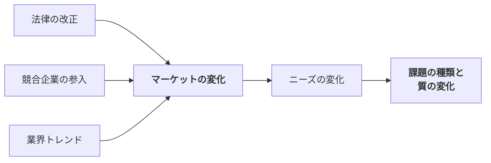

## 原則

- テクノロジーを理解する目的は「プロダクトでより良い課題解決をするため」。テクノロジーそのものではなく、その先にある課題解決に着目する。
- 常に変化に敏感で、適応し続けることがプロダクト開発の成否を分ける。

## マーケットの変化に敏感でいる

マーケットの中で、自社プロダクトがどの立ち位置にいるかを理解する。担当するプロダクトの業界情報は常にキャッチアップする。

<Figure src="/figures/n0-2-2-1762.webp" alt="マーケットの枠の中に、自社プロダクトと競合A〜Dの円が並ぶ。マーケットの中における自社プロダクトの立ち位置を理解する" />

- 法律の改正
- 競合企業の参入
- 業界トレンド・流行り

マーケットが変わると、ユーザーのニーズが変わり、課題の種類と質が変わる。

<Diagram>

</Diagram>

1年前と今でまるでニーズが違うこともある。PMがマーケットの変化を追えていないと、作ったプロダクトが時代遅れになる。

## テクノロジーに敏感でいる

テクノロジーは急激に進化し、「出口となるプロダクト」を見つけたときに一般化する（ビッグデータとAI、ブロックチェーンと暗号通貨など）。技術が進化すると、不可能だった機能が提供可能になる。この変化に適応することが大事。

| 考えなくて良いこと | 考えるべきこと |
| --- | --- |
| AIはどのような技術で動くのか | AIを使ってプロダクトをどう改善できるか。そのためにAIの特徴とできることを把握する |

PMはテクノロジーを完全に理解していなくても良い。しかし、テクノロジーがもたらす「プロダクトの可能性」は理解する。自社プロダクトがどんなテクノロジーで作られているかの知識は必要で、これがないと適切な判断ができない。

## 情報収集を習慣にする

時代の大きな変化は、国の政策、法律の改正、革新的なテクノロジー、業界トレンド、天変地異・疫病から生まれる。

1. ニュース
2. 専門誌
3. カンファレンス
4. SNS
5. コミュニティ

<Note title="目安">メディアを毎日チェックする、業界で有名な人をSNSでフォローする、業界独自の情報ルートを確保する。必要な情報を素早く得ることで、成功確率が最大化される。</Note>
