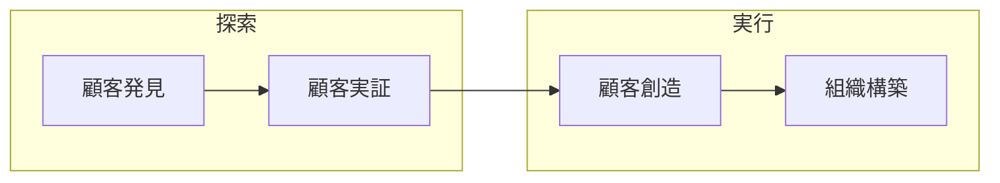

## 原則

- まず自分たちの顧客を発見する。顧客のフィードバックで仮説が誤っていたと分かれば、仮説を改めるか、新たな仮説で軌道修正（ピボット）する。
- 顧客の関心が低いなら、仮説を変えて軌道修正する。

## 進め方

ビジネスモデルの探索は「顧客発見 → 顧客実証」、実行は「顧客創造 → 組織構築」の順に進む。

<Diagram>

</Diagram>

発想したアイデアからビジネスモデルの仮説を作り、顧客ニーズの前提を検証したうえで、実用最小限の製品（MVP）で解決策への反応を確かめる。

## プロセス：マンダラートで「不」を探す

<Steps>
  <Step title="思い浮かぶ8人を書く">中央の枠に、自分・母親・高校の友人・会社の同僚・想定顧客などを書く</Step>
  <Step title="外枠に写す">8人を、外側の8つのブロックの中央にコピーする。全部埋まらなくても良い</Step>
  <Step title="その人の「不」を書く">いつ・どんなときに、どこに不満・不安・不便を感じるかを周りに書く</Step>
  <Step title="最も重要な「不」を選ぶ">9×9のマスから、最も解決したい「不」を選ぶ</Step>
</Steps>

<Figure src="/figures/n1-2-1-3081.webp" alt="マンダラートで想定顧客の「不」を探した例。中央の枠に自分・母親・高校の友人・地元の友人・近所の人・想定顧客などを書き、外側のブロックでそれぞれの「不」（通勤の不便など）を書き出し、9×9のマスから最も重要な「不」を選ぶ" caption="9×9のマスを埋め、最も重要な「不」を選ぶ" />

<Note title="目安">埋められなくても、埋めようと考えることが重要。「誰の、どんな不を、どんな方法で解決したいか」という形に落とすと、顧客像が明らかになる。</Note>

## 提供価値を見つける

<Steps>
  <Step title="不平・不満を書き出す">事実・思い（感情）・理由の観点で詳しく書く。例：通学時間が長くて塾に通えず、勉強しづらい</Step>
  <Step title="「できる」に変換する">実現性を無視して「…できる」「…がある」に言い換え、発想の偏りを外す</Step>
  <Step title="最も重要な「できる」を選ぶ">最も実現したい提供価値を選び、なぜ取り組みたいかを言語化する</Step>
</Steps>

<Figure src="/figures/n1-2-1-3085.webp" alt="顧客の声から提供価値を見つける流れ。不平・不満の声を「…できる」「…がある」に変換し、その中から最も実現したい「できる」を選ぶ" caption="「不」を「できる」に言い換えて、提供価値を選ぶ" />

## 思い込みを外して解決策を考える

提供価値の実現を「できないかも」と思わせる思い込みを書き出し、それを取り払った解決策を考える。

<Figure src="/figures/n1-2-1-3087.webp" alt="思い込みを取り払って解決策を考える例。顧客の「不」は、通学時間が長くて塾に通えず勉強しづらいこと。「授業は教室で受けるもの」という思い込みを取り払うと、先生がいらないオンライン授業という解決策が生まれる" caption="例：「授業は教室で受けるもの」を取り払う" />

ロジカルシンキングだけでは生まれない、斬新なアイデアが生まれる可能性がある。新しいビジネスチャンスが見つかる、イノベーションを促す、リスクや困難を恐れなくなる、社内の連携が強まるなどの効果もある。
