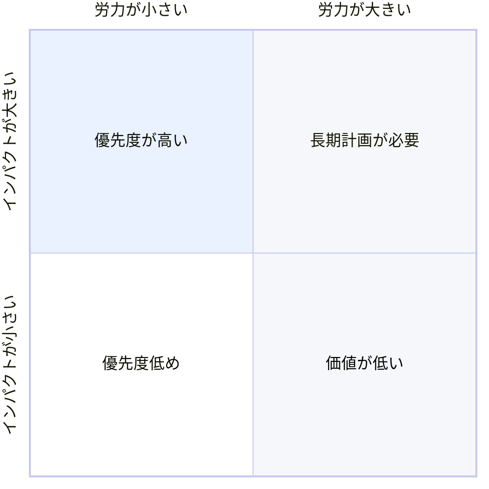

## 原則

- 課題を「やるべきことリスト」に留めず、戦略的に扱う。
- 開発段階になってから「本当にこの機能は必要だったのか」と後悔しないために、ディスカバリーの段階で課題を把握する。
- 優先順位づけは動的。前提が変われば見直す。

## プロセス：洗い出して選ぶ

<Steps>
  <Step title="情報を集める">アンケートだけでなく、データ分析、ユーザーインタビュー、問い合わせ履歴など多角的に集める</Step>
  <Step title="整理・可視化する">一覧化し、何が分かっていて何が分かっていないかを見えるようにする</Step>
  <Step title="課題の仮説を立てる">類似・関連する課題をグルーピングし、根本的な原因や上位の課題を推定する</Step>
  <Step title="優先度を判断して取捨選択する">投資対効果やインパクトを評価し、戦略に基づいて選ぶ</Step>
</Steps>

## データを整理する

| データ | 整理のしかた |
| --- | --- |
| 定量データ | 平均値・中央値・標準偏差で全体の傾向をつかむ。気になればクロス集計やセグメント別に見る。分散が大きい項目や、極端な回答をしたユーザーの属性にも着目する。回答数の極端な少なさや選択肢の偏りは、質問設計を疑う |
| 定性データ | 大量の自由回答はテキストマイニングで頻出語や共起を可視化する。カテゴリーに分けてラベルをつけ、「UI」「操作性」「機能不足」のような大きな課題のグループにする |

定量データは「どの程度大きな問題か」、定性データは「なぜその問題が起きているのか」を示すのに向いている。**掛け合わせると、課題を立体的に把握できる**。たとえば満足度が低いセグメントの自由回答を詳しく見て、具体的な原因を特定する。

## 課題を分類する

- **3階層で整理する**：大項目（マクロ）・中項目・小項目（具体的な課題）。どの領域に課題が集中しているかが見え、大項目で優先順位をつけ、小項目で深掘りできる。

<Figure src="/figures/n2-2-3-916.webp" alt="課題の分類・グルーピングのピラミッド。下から大項目（マクロな視点で分類）、中項目（やや細かい視点で分類）、小項目（具体的な課題を特定）の3階層" caption="大項目・中項目・小項目の3階層で整理する" />

<Cards cols={2}>
  <Card label="真の課題と表面的な課題を分ける">「UIが使いにくい」「〇〇機能が欲しい」という声の奥に、どんな目的や環境で使っているかという根本的な課題がある。表面上の解決策が真の課題を解くとは限らない</Card>
  <Card label="組織内の視点とすり合わせる">カスタマーサポートの問い合わせ履歴、営業が把握している顧客ニーズ、データ分析と突き合わせる。裏付けが強まり、別の角度から見るヒントも得られる</Card>
</Cards>

## 優先順位づけのフレームワーク

### Impact vs. Effort

<Diagram caption="インパクトと労力の2軸で課題をマッピングする">

</Diagram>

インパクトにはユーザー満足度の向上やビジネスへの寄与、労力には開発の時間・リソース、部署間の調整、技術的な難易度を含める。視覚的に分かりやすく、議論がスムーズになる。

### RICEスコア

RICE = (Reach × Impact × Confidence) ÷ Effort

| 要素 | 内容 |
| --- | --- |
| Reach | どのくらいのユーザーに影響があるか。MAU、利用頻度など |
| Impact | ユーザーへのインパクト。小0.25／中0.5／大1／非常に大2 など |
| Confidence | 推定への自信度。80%なら0.8、50%なら0.5 |
| Effort | 開発や実装にかかる工数。大きいほどスコアは下がる |

客観性を保ちながら比較できる。事業規模が大きいほど「何人に影響するか」が重要になるため、SaaSやBtoCで多用される。

### Value vs. Complexity

Valueには顧客満足、売上貢献、戦略的な価値、Complexityには技術的難易度、組織的調整、法的規制への対応を含める。定量化しにくいビジネス価値や組織的な課題感を盛り込みやすい。複雑度が低く価値が高いものを優先する基本は同じ。

## 注意点

| 注意点 | 内容 |
| --- | --- |
| ユーザーとビジネスのバランス | 要望が多いからと全部を最優先にすると、収益性や長期戦略が後回しになる。逆にユーザーの声を無視すると離反を招く |
| 短期と長期 | 短期的に成果が出やすい課題ばかりだと、長期的に重要な課題を先送りにする |
| データの信頼度 | サンプルが少ない、偏ったセグメントからしか集まっていない場合は、RICEのConfidenceを低めにするなど信頼度を考慮する |
| 動的であること | マーケット、競合、ユーザーの利用シーンが変われば優先度も変わる。定期的な見直しを前提にする |
