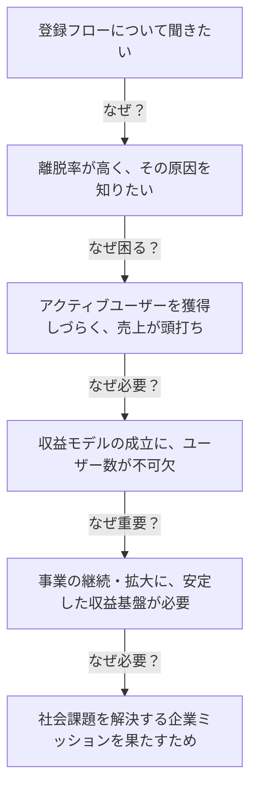

## 原則

- ヒアリングは情報収集ではなく、ビジネスやプロダクトの意思決定を支える「答え」を導くために行う。
- どこに焦点を当てるかで、ヒアリングの設計・質問内容・進め方が大きく変わる。
- ユーザーヒアリングの成功は、ビジネスゴールとのつながりを明確にした計画から始まる。

| 良い目的 | 悪い目的 |
| --- | --- |
| 既存ユーザーの満足度を上げるために、UIを全面的にリニューアルするか否かを検討する | ユーザーがどのように使っているのか、色々と聞いてみる |

## フレーミング

目的や目標を、どのような枠組みで捉えるか・位置づけるか。

<Steps>
  <Step title="最終目的を確認する">例：新規ビジネスモデルの検討 → 既存顧客や潜在顧客のニーズを発掘したい</Step>
  <Step title="データドリブンな仮説を立てる">「こんなユーザー課題があるのでは？」「この層にリーチすれば売上が伸びるのでは？」</Step>
  <Step title="質問を大まかに設計する">仮説を検証するための質問を考える</Step>
  <Step title="文書化して共有する">何をどれくらい掘り下げるか、どの優先度かを書く</Step>
</Steps>

<Note title="目安">フレーミングの文書は「最終目的・仮説・ヒアリングで得たい情報・優先度の高い項目・SMARTゴールとの関連」で構成する。誰が見ても目的・仮説・ヒアリング項目がすぐ分かる状態を目指し、図解や箇条書き、用語の補足を使う。リハーサルや途中経過、完了後の結果に合わせて見直す。</Note>

### 目的を掘り下げる：5Whys

「なぜ」を5回問い、ヒアリングの目的を事業の目的までつなげる。

<Diagram caption="例：登録フローのヒアリングを、企業ミッションまでつなげる">

</Diagram>

## ゴール設定：SMART

| 要素 | 意味 | 例（UI改善のヒアリング） |
| --- | --- | --- |
| Specific | 具体的 | UIに関する満足度や不満点を、操作シーン別に把握する |
| Measurable | 測定可能 | 20名のインタビューで主要な不満要素をリストアップし、優先順位を3段階で評価する |
| Achievable | 達成可能 | 4週間以内にインタビューと分析ができる |
| Relevant | 関連性がある | 問い合わせコストを削減する全社目標に沿っている |
| Time-bound | 期限がある | 次の開発スプリント開始までに、意思決定の根拠をそろえる |

<Caution>ゴールを複数設定するとぶれやすい。ゴールの抽象度を上げすぎない。ゴールはチーム全員で共有し、常に参照する。</Caution>

## リサーチクエスチョン

調査において答えを求めるべき問い。ゴールを実現するために解き明かす必要がある、個別の問いのこと。リサーチクエスチョンがあれば、得た情報を整理しやすい。

| ゴール | リサーチクエスチョン |
| --- | --- |
| UIリニューアルの可否を判断できる根拠を得る | UIのどの部分に不満を感じているか（ボタン配置？画面遷移？見づらさ？）。不満の原因は何か（狭いスマホ画面？視力の違いを想定していない？初期設定が複雑？）。不満を感じるのはどんなときか（移動中の片手操作？夜間モード？） |

粒度と優先順位は、「最もクリティカルな問いは何か」「どうしても押さえたい問いはどれか」「時間や流れによってカットしても良い問いはどれか」で決める。

## プロセス：ゴールとリサーチクエスチョンを作る

<Steps>
  <Step title="現状を把握する">ユーザージャーニーの見直し、KPIやデータ（DAU/MAU、離脱率、NPSなど）の確認、チーム内インタビューでボトルネックの仮説を立てる</Step>
  <Step title="ゴールを設定する">SMARTで書く</Step>
  <Step title="リサーチクエスチョンを作る">ゴールから逆算して立てる</Step>
  <Step title="合意を得る">チームで合意形成し、インタビュー内容に落とし込む</Step>
</Steps>

その後、実施・分析・再調査へ進む。

### KGI・KPIとつなげる

KGIはゴールそのもの、KPIはゴールに至るプロセスを測る道標。全体ビジョンを確認し、ヒアリングの目的と成果物を定義したうえで、KGIを1〜2つに絞り、達成に必要な要素からKPIを設定する。担当者と合意し、モニタリングの方法と頻度を決めて、PDCAを回す。

### リスクと制約条件

- リスク：ゴールを脅かす可能性がある不確実な要素
- 制約条件：あらかじめ定められ、変更が難しいか不可能な条件

| 段階 | 起こりうるリスク |
| --- | --- |
| 計画 | 対象ユーザーを確保できない、質問項目が多すぎる・少なすぎる、合意不足による時間や予算の問題 |
| 分析 | 分析が間に合わない・スキルが足りない、チーム内でインサイトを共有しきれない |

## 期待値ギャップ

「ユーザーが抱く理想や期待」と「現実のサービスや機能の提供価値」とのズレ。速度（もっと速いと思っていた）、導入ハードル（簡単だと思ったのに初期設定が複雑）、サポート（すぐ助けてくれると思っていた）などで生まれる。ユーザーヒアリングが、このギャップを見極めるカギになる。

### ギャップが生まれる理由

1. 情報不足：使い方・料金・導入メリットなどが十分に伝わっていない
2. 誤った思い込み：作り手が「ユーザーはこう思っているはず」と決めつける
3. 市場環境の変化：競合の登場で「当たり前」の水準が上がったのに、プロダクトが追いついていない

### ギャップを埋める

<Steps>
  <Step title="現状把握">集まった声をカテゴリ分けし、理想像や欲求を洗い出す</Step>
  <Step title="明確化">理想と現在の提供価値のズレを、定量・定性で可視化する</Step>
  <Step title="改善策の検討">情報提供・機能・サポート体制のどこを変えれば縮まるかを考える</Step>
  <Step title="実行と検証">改善後に再びヒアリングやデータ分析で解消度を測る</Step>
</Steps>

優先順位は、放置したときの影響（離脱や不満の爆発につながるか）、改善のコストと工数、将来の拡張性で決める。ユーザーの期待値は常に変わるため、再ヒアリングを続けて「今」の理想を追いかける。

<Note title="補足">ケース：有料版が増えないSaaSで「料金に抵抗があるのでは」と考えてヒアリングしたところ、実際のギャップは初期セットアップの分かりにくさ、サポート不足、既存ツールとの連携不足だった。思い込みで施策を決めず、ギャップを確かめてから動く。</Note>
