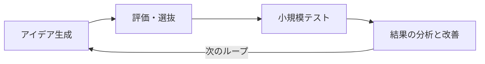
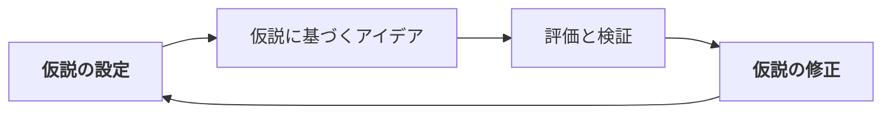

## 原則

- 発散と評価を分ける。出している最中にネガティブチェックをしない。
- 発散の前に、課題の再定義・制約条件・目的をそろえる。共有しておくと発散の方向性が定まる。
- 評価基準は事前に決める。主観や好き嫌いでアイデアが選ばれるのを防ぐ。

## なぜ発散するのか

| 発散しないと | 発散すると |
| --- | --- |
| ありきたりな解決策に落ち着きやすい | 多様性を取り込み、斬新で効果的な施策が生まれる |
| 課題の本質を捉えないまま表面的な施策で終わる | 複数のアプローチを比較検討できる |
| 差別化が難しくなる | チーム内のコミュニケーションや連帯感が高まる |

## 発散の前にそろえるもの

| ポイント | 問い |
| --- | --- |
| 課題の再定義 | 本当に解くべき課題は何か |
| 制約条件・前提条件 | 人・モノ・資金・時間、法規制、組織構造など、現実的な制約は何か |
| 目的・期待成果 | なぜ、どんなインパクトを目指してアイデアを出すのか |

## ブレーンストーミング

<Cards cols={2}>
  <Card label="批判禁止">アイデアを批判せず、肯定・受容の姿勢を保つ</Card>
  <Card label="自由奔放">どんなに荒唐無稽なアイデアでも歓迎する</Card>
  <Card label="量を重視">短時間にできるだけ多く出す</Card>
  <Card label="結合・便乗歓迎">他人のアイデアに便乗したり組み合わせたりする</Card>
</Cards>

<Steps>
  <Step title="テーマを1つに絞る">課題の再定義を踏まえて明確にする</Step>
  <Step title="ファシリテーターが進行する">批判的な発言が出ないように注意する</Step>
  <Step title="別の視点を提示する">アイデアが落ち着いてきたら、キーワードを投げて刺激を与える</Step>
  <Step title="まとめる">ある程度の時間で区切り、集まったアイデアをまとめる</Step>
</Steps>

## SCAMPER法

ゼロから生み出すというより、すでにある何かに新しい切り口を与える方法。

| 観点 | 問い |
| --- | --- |
| Substitute（代替） | 置き換えられるものはないか |
| Combine（結合） | 別のものと組み合わせられないか |
| Adapt（応用） | 他の分野や既存アイデアを取り入れられないか |
| Modify（変更） | サイズ・形・色・デザイン・工程などを変えられないか |
| Put to other uses（転用） | 別の目的や用途に流用できないか |
| Eliminate（削除） | 削っても成り立たないか。無駄を省けないか |
| Rearrange（再配置） | 工程・順序・配置を変えられないか |

## 発散を促すマインドセット

<Cards cols={2}>
  <Card label="ネガティブチェックの先送り">「どうせ無理」はいったん脇に置く</Card>
  <Card label="面白がる">ヘンテコなアイデアも面白がって聞く姿勢が、チーム全体の発散を活性化する</Card>
  <Card label="心理的安全性">どんな意見も尊重される場にする。失敗例を攻撃せず、建設的にフィードバックする</Card>
  <Card label="ビジョンの共有">何を実現したいかを共有すると、発言の意図が理解され、批判ではなく共創的なやりとりになる</Card>
</Cards>

## 評価の前に「種」を温存する

<Steps>
  <Step title="粗く仕分ける">「面白い・ユニーク」「似通っている」「実現性に疑問」「すぐ実現できそう」など、厳密な軸を設けず感覚的にグルーピングする</Step>
  <Step title="一旦寝かせる">一晩以上あけて見直す。興奮や先入観が抜け、客観的に判断できる。ワークショップなら翌日や翌週に全員で再確認する</Step>
  <Step title="少数の有力案を精査する">コスト・インパクト・リスク・実行可能性など複数の軸で比べる。1つに絞りすぎない。既存のデータや顧客インサイトに合致しているかも確かめる</Step>
</Steps>

## プロセス：評価して絞り込む

時間・お金・人材には限りがあり、すべてのアイデアは試せない。アイデア生成 → 評価・選抜 → 小規模テスト → 結果の分析と改善、のループを早く回す。

<Diagram>

</Diagram>

評価では、売上・利益、顧客満足度、ユーザー数など、組織のゴールやKPIとの整合性を見る。

<Steps>
  <Step title="目標と評価基準を設定する">市場規模、実現可能性（技術・コスト・人的リソース）、収益性、社会的インパクト、競合優位性</Step>
  <Step title="概略評価でふるい分ける">A：有望で優先的に検証する価値がある／B：条件次第で変わる。追加情報が必要／C：見込みが低い。評価理由もメモしておく</Step>
  <Step title="詳細評価と検証プランを作る">市場調査、技術的実現性、小規模テストやPoCの設計、リスク分析、収益モデルの試算。早い段階でユーザーや市場の反応を得る</Step>
  <Step title="優先度とリソース配分を決める">インパクト、実行しやすさ、リスクレベル、戦略的重要度で判断する。ICEスコア（Impact・Confidence・Ease）なども使う</Step>
  <Step title="見直し続ける">市場動向、実証実験の結果、チーム体制や予算、方針転換に応じて、評価基準と優先度を更新する</Step>
</Steps>

## 仮説と組み合わせる

「こうすれば解決できるのではないか」という仮説がしっかりしているほど、根本的な問題や成功要因が明確になり、アイデアを評価しやすい。

- 仮説を言語化する。例：ユーザーは〇〇が原因で離脱している
- 検証可能な形にする。例：このアイデアを入れれば直帰率が10%改善するはず
- 複数の仮説があれば、優先して検証するものを選ぶ

仮説とアイデアは、両者を同時に進める。

<Diagram>

</Diagram>

## 注意点

| 注意点 | 対策 |
| --- | --- |
| バイアス | 保守バイアス（現状維持）、確証バイアス（都合のよい情報を集める）、アンカリング（最初の情報に引きずられる）。複数人の客観的な視点を入れ、意図的に反対意見を聞く |
| 多様性の喪失 | あえて尖ったアイデアを残す「面白そう」枠を設ける。潜在的な市場インパクトなど定性的な観点も評価に含め、長期的な成長の可能性も考える |
| 組織文化を損なう | 評価を「より良い解決策を見つけるステップ」と位置づける。否定だけでなく改善案も示す。評価の目的と方法をチーム全員で共有する |

<Note title="事例：社内のコミュニケーション改善">情報共有が遅くミスが頻発している課題に対し、「部署間の共有ルールが不明確」「雑談が減った」「会議が多すぎる」の3つの仮説を立ててブレストした。概略評価でAになったチャットツール導入とオンライン雑談タイムを、予想効果・リスク・検証方法で詳細評価した。最終的に、即時着手でき効果測定しやすいチャットツール導入を最優先にし、効果と実行しやすさの順に段階的に実証実験を進めた。</Note>
