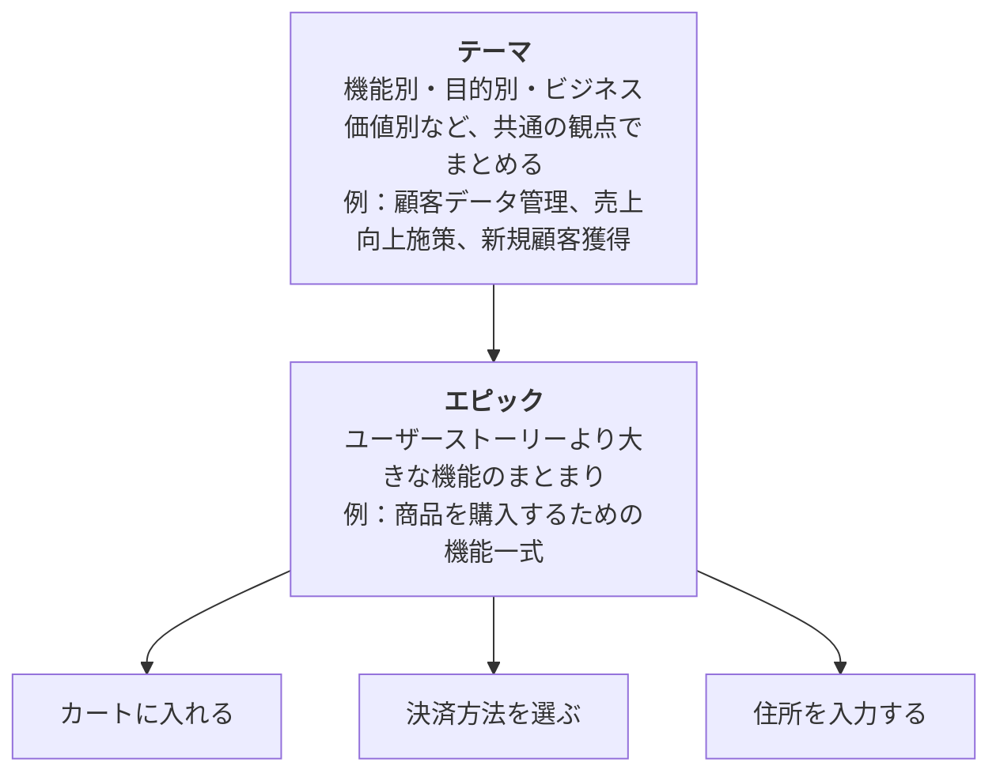

## 原則

- 機能要求は「とにかく何ができるのか」を明確にする段階。
- 会議室にこもって「きっとユーザーは〇〇を望んでいるはず」と想定だけで決めない。必ず実際のユーザーから客観的な情報を得る。
- 全部は同時に満たせない。優先度をステークホルダーと一緒に決める。

## 機能要求とは

システムやサービスが「何を実現するべきか」を具体的に示す要求事項（Functional Requirements）。新しいアプリなら「行動記録を入力できる」「入力した行動を分析してグラフ化する」「グラフをSNSに共有できる」のように、「〇〇ができる状態」を明文化する。

言語化することで、開発チームに「何を作るのか」の共通認識が生まれ、ステークホルダーと合意しやすくなり、後の仕様詰めもスムーズになる。

## プロセス：機能要求を洗い出す

<Steps>
  <Step title="目的・ゴールを確認する">プロジェクトの目的とゴールの指標を共有し、向かう方向を定める</Step>
  <Step title="ステークホルダーを特定する">プロジェクトに関わる利害関係者を明確にする</Step>
  <Step title="情報を集める">ユーザーインタビュー、アンケートなどで情報を集める</Step>
  <Step title="現状を分析して課題を洗い出す">現在の問題点や課題を明確にする</Step>
  <Step title="機能案をブレストする">課題解決のための機能アイデアを出し合う</Step>
  <Step title="優先順位をつける">出たアイデアに優先順位をつける</Step>
  <Step title="文書化してレビューする">決めた機能要求を文書化し、関係者でレビューする</Step>
</Steps>

## ユーザー要求を集める方法

| 方法 | ポイント |
| --- | --- |
| ユーザーインタビュー | 開始時に目的を伝えてリラックスしてもらう。オープンクエスチョンを使い、Yes/Noで終わらせない。5Whysで「なぜ」を繰り返して本質に迫る |
| アンケート | 満足度、利用頻度、興味のある機能、課題などを多数から集める。どんな仮説を検証したいのかを事前に明確にする |
| 観察・行動調査 | 普段の使い方、操作手順、そのときの感想を観察・記録する。ユーザー自身も気づいていない潜在的な課題やボトルネックが見つかる |
| ワークショップ | 複数のステークホルダーや代表ユーザーを集め、付箋やホワイトボードで自由に出し、整理・分類し、ファシリテーターが合意形成をリードする |

## ステークホルダーと合意する

ユーザーの声に加えて、次の要求も考慮する。

| 要求 | 例 |
| --- | --- |
| ビジネス的要求 | 売上目標、リリース時期、ブランディング方針 |
| 技術的要求 | 既存システムとの連携難易度、使えるプラットフォームやフレームワーク、技術者のスキルセット |
| 運用上の要求 | サポートコスト、人員配置、メンテナンス性 |

相手が求める成果物と懸念点を把握して尊重する。モックアップやワイヤーフレームで成果物のイメージを視覚的に共有する。一度で完璧を目指さず、小さく作って確認しながら進める。ステークホルダー間で優先事項が衝突したら、こまめに情報共有の場を設け、話し合いやすい雰囲気をつくって折り合いをつける。

## 整理と優先順位づけ

### MoSCoW法

| 区分 | 内容 |
| --- | --- |
| Must | 絶対に必要な機能 |
| Should | あったほうが望ましい機能 |
| Could | あれば嬉しい機能 |
| Won't | 今回のスコープには含まない機能 |

スコープが膨れ上がるのを防ぎ、開発の焦点を定めやすくなる。

### そのほかの手法

- **カスタマージャーニーマップ**：利用までの体験を時系列で可視化し、各場面で必要な機能と直面する課題を洗い出し、どの場面にどの機能が重要かを評価する。
- **コンセプトモデル・ドメインモデリング**：機能同士の関連、データ構造、ビジネスルールを概念的に図示する。大規模システムや複雑なドメインで特に有効で、不要な機能や抜け漏れも見つかる。

## エピックとテーマ

要求が増えると全体像が見えにくくなる。大きなまとまりで扱うと、優先度を大きな単位から小さな単位へ段階的に検討でき、抜け漏れも防ぎやすい。

<Diagram caption="例：ECサイト。ユーザーストーリーは、エピックを分解した単位">

</Diagram>

- テーマは「なぜ必要なのか」「成功指標は何か」を言語化しておくと、効果測定がしやすい。設定しすぎると混乱するので、少数精鋭に絞る。
- エピックはプロダクトの中核機能を大まかにブロック化するイメージ。大きすぎると優先度をつけにくいので、サブエピックに分ける。
- エピックとテーマの違いが曖昧になりやすい。言葉の使い方をチームで決めておく。

<Note title="関連">バックログでの扱い方は <NoteLink id="n7-11-1" /> を参照。</Note>

## ドキュメントとレビュー

- フォーマットはチームで扱いやすい形式に統一する
- 更新履歴を残す（Wiki、Issueトラッカー、Gitなど）
- 詳細設計に踏み込みすぎず、機能の内容と目的が分かる程度にまとめる
- 関係者全員が目を通し、意見を出せるレビューの場を設ける

## よくある失敗

| 失敗 | 回避策 |
| --- | --- |
| ユーザー不在のまま想定で決める | 実際のユーザーにインタビュー、テスト、アンケートを行い、想定外のニーズを見つける |
| 要求が増えすぎて優先度をつけられない | 「どうせならこれも」で機能が増え続けると、期間やコストが破綻する。MoSCoW法などで優先順位を定め、スコープを定期的に見直す |
| ドキュメントが更新されず放置される | バージョン管理と定期レビューをプロセスに組み込み、担当者を決める。更新を開発サイクルの一部にする |
