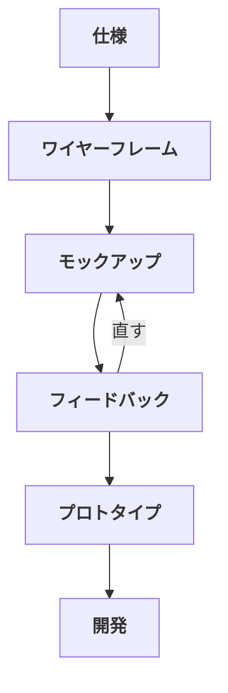

## 原則

- デザイン要件定義とは、あらかじめ成果物の詳細や目的を明確にしておくこと。
- 「とりあえずいい感じに作って」はNG。手戻りのもとになる。
- 見積もりは、フィードバックを含む各工程を考慮して立てる。

## プロセス

<Diagram caption="フィードバックを受けて直す往復も、見積もりに入れておく">

</Diagram>

## デザイン要件定義

| フェーズ | 決めること |
| --- | --- |
| 1 | 目的、課題、ターゲット、期待するアクション、目標値 |
| 2 | 具体的なデザイン規定（レイアウト、トンマナなど） |

## よく使うUI部品

| 部品 | 内容 |
| --- | --- |
| ポップアップ | 外側の操作ができる。サイドバーやコンテキストメニューなど用途は限定的 |
| モーダル | 外側の操作ができない。一般的に使われる |
| ダイアログ | ユーザーが目的に到達するプロセスで表示するウィンドウ |
