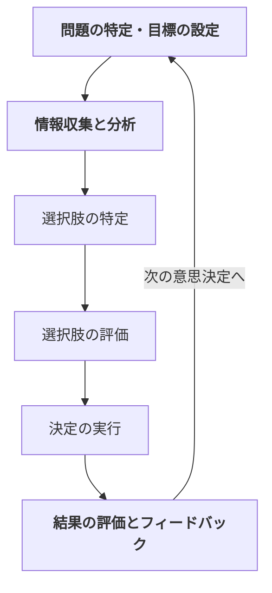

## 原則

- PMは、なんのために分析をするのか、結果を受けてどんな意思決定につなげるのかを常に意識する。
- 自分の顧客に関するデータの分析と理解は人に任せない。データアナリストがいなければ、PMが担うのが普通。
- データ分析の流れの中で、PMが特に担うのは「問題の定義」と「結果の評価」。

## 意思決定のどこで使うか

意思決定のプロセスのうち、データ分析が関わるのは、問題の特定・目標設定、情報の収集と分析、結果の評価とフィードバックの3カ所。

<Diagram caption="青い3か所でデータ分析を使う">

</Diagram>

| ステップ | 例：新規ユーザー獲得数が減っているアプリ |
| --- | --- |
| 問題の特定・目標の設定 | 新規ユーザー獲得数が減少している。3カ月で30%向上させる |
| 情報収集と分析 | インストール数、レビューやインタビュー結果、競合の機能やマーケティング、業界動向を調べ、要因を特定する |
| 選択肢の特定 | UI/UX改善、新機能の追加、プロモーション強化 |
| 選択肢の評価 | コスト、効果、実行可能性、リスクを比べる。UI/UX改善や新機能は開発リソースが、プロモーションは費用が要る |
| 決定の実行 | 新機能の追加とプロモーション強化を選んで実行する |
| 結果の評価とフィードバック | 獲得数やレビューを分析して効果を測り、次の意思決定に活かす |

## 問題の定義：5つの活用シーン

| シーン | 内容 | ECサイトの例 |
| --- | --- | --- |
| パフォーマンスの監視と最適化 | KPIや目標達成度など重要な指標を定義し、計測する | 訪問者数（広告経由・自然検索経由）、CVR、カート追加率、平均注文金額 |
| ユーザーフィードバックの理解 | フィードバックやサポートリクエストを分析し、改善につなげる | レビューをテキストマイニングし、品質や配送の問題を特定する |
| 市場調査 | どこまでを市場・競合とみなし、顧客をどの軸で評価するかを決める | 購入回数・頻度・金額・カテゴリでセグメントを分ける |
| 新機能の評価 | リリースした機能や改善のパフォーマンスを評価する | 商品ページのデザインをABテストし、CVRを比べる |
| 予測と戦略立案 | 過去のデータやトレンドから将来を予測する | 販売データと季節性から需要を予測し、在庫を最適化する |

<Figure src="/figures/n6-1-1-1924.webp" alt="パフォーマンスの監視と最適化の例：ECサイトのKPIツリー。売上を訪問者数（広告経由・自然検索経由）、CVR、カート追加率、平均注文金額などの指標に分解する" caption="例：ECサイトのKPIを分解して計測対象を決める" />

## 結果の評価：PMの役割

| 役割 | 内容 |
| --- | --- |
| データの信頼性を評価する | 一部のユーザーに過度に依存していないか、収集方法に問題がないか。正しいデータセットを対象にした分析かをチェックする |
| ビジネスの文脈で解釈する | 新機能のリリース後にエンゲージメントが下がったのは、受け入れられていないからか、季節性など外部要因か |
| データで意思決定する | ABテストで新デザインのCVRが高ければ、採用するかを決める |

## KKDとバイアス

勘・経験・度胸（KKD）だけの意思決定がよくないのは、勘にはバイアスがかかり、経験は前例のないチャレンジに使えないから。ただし、いくら分析しても100%の予測は難しいので、一定の度胸は必要。

| バイアス | 内容 | PMの場面での例 |
| --- | --- | --- |
| 確証バイアス | 自分の信念や仮説を支持する情報ばかりに注意を払い、反証を無視する | インタビュー結果から、ポジティブな意見だけを拾い、批判や懸念を過小評価する |
| アンカリング効果 | 最初に提示された情報に引きずられる | 優先度を決める場で、最初に「機能Aが重要」と言われると、BやCが十分に評価されない |
| グループシンク | 調和を重視し、異なる意見を無視・抑圧する | リーダーのアイデアに誰も異議を唱えず、より適切なアイデアがあったのに採用される |

<Note title="対策">主観や感覚だけでなく、数字やロジックに裏付けされた意思決定を行う組織文化をつくる。</Note>
