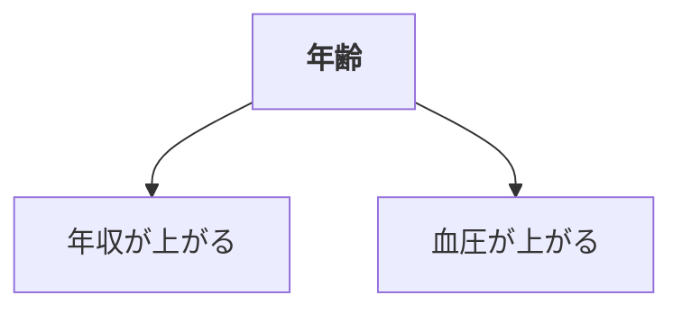

## 原則

- 相関関係 ≠ 因果関係。
- 見えない要因（潜伏変数）があると、因果関係がないのにあるように見える（疑似相関）。
- KPIを上げるために何に注力すべきか迷ったら、相関分析で候補の変数を探る。

## 相関分析とは

2変数の関係性を調べる。相関係数は-1から1の値を取り、絶対値が相関の強さを表す。正なら一方が増えるともう一方も増え、負なら一方が増えるともう一方が減る。

| 相関係数の絶対値 | 解釈 |
| --- | --- |
| 0.0〜0.2 | ほとんど相関がない |
| 0.2〜0.4 | 弱い相関 |
| 0.4〜0.6 | 中程度の相関 |
| 0.6〜0.8 | 強い相関 |
| 0.8〜1.0 | 非常に強い相関 |

<Figure src="/figures/n6-1-3-2100.webp" alt="相関分析とは何か。相関係数の絶対値の目安と、正の相関・相関なし・負の相関の3種類の散布図" caption="相関係数の目安と散布図" />

スプレッドシートではCORREL関数で求められる。

## プロダクトでの相関の例

| 変数 | 傾向 |
| --- | --- |
| ページのロード速度と離脱率 | 速いほど離脱率が低い。遅いと耐え切れずに離脱する |
| エンゲージメントとリテンション率 | 頻繁に使うほど継続利用しやすい。特定の機能をよく使うユーザーは続けて使う可能性が高い |

## 疑似相関

<Diagram caption="例：年収と血圧。年齢という第3の要因が、両方を動かしている">

</Diagram>

| 例 | 見かけ | 実際 |
| --- | --- | --- |
| 年収と血圧 | お金持ちは高価な食事が多いので高血圧になる？ | 年齢が上がると収入も血圧も上がる傾向がある |
| アクティブユーザー数と新機能の使用数 | 新機能がユーザーを引き付け、アクティブユーザーが増えた？ | リリースに合わせたプロモーションが注目を集め、全体のアクティブユーザーを増やした可能性がある |

<Note title="関連">施策の効果を因果として確かめるには <NoteLink id="n6-3-2" /> を参照。</Note>
