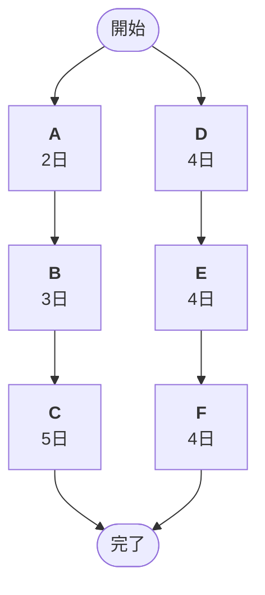

## 原則

- クリティカルパス上のタスクは「絶対に遅延できない」タスク。
- 工期を短くしたいなら、まずクリティカルパス上のタスクを短くする。短縮した分がそのまま全体の期間に反映される。
- クリティカルパスは変わりうるし、複数あることもある。

## クリティカルパスとは

「Aが終わらなければBに着手できない」という依存関係が積み重なった結果、最も長くなった経路。

<Figure src="/figures/n7-4-3-2609.webp" alt="ガントチャート上のクリティカルパス。依存関係でつながったタスクの連鎖のうち、最も長い経路が強調されている" caption="依存関係でつながったタスクの最長経路" />

## 例

<Diagram caption="経路1は合計10日、経路2は合計12日。長い経路2がクリティカルパス">

</Diagram>

プロジェクトがこの2つの経路でできていれば、12日の経路2がクリティカルパス。これを1日でも遅らせると、プロジェクト全体の納期に影響する。

## なぜ重要か

| 観点 | 内容 |
| --- | --- |
| 遅延の原因を特定・回避する | 特定する最大の意義。全体を遅らせる要因を事前に取り除ける |
| 優先順位をつける | 全タスクを同列に扱うと「なんとなく全部重要」になる。クリティカルパス上にないタスクは、調整の優先度が相対的に低い |
| 余裕のないタスクを見つける | 余裕（スラック）が少ない・ゼロのタスクの連鎖がクリティカルパス |
| リソースを配分する | クリティカルパス上のタスクの工数・期間・人をまず確保する。限られていれば優先してアサインする |
| 工期を短縮する | どこを調整すべきかの視界が変わる |

## 進め方

1. プロジェクトに必要なすべてのタスクを洗い出す（WBSを作りながら整理する）
2. 各タスクの依存関係を明示する
3. 最も時間のかかる経路を求める。代表的な方法がPERT/CPMで、タスクをノード、依存関係を矢印で結んで最長経路を求める

進行中は、クリティカルパス上のタスクの進捗を特に厳しくチェックし、遅れたらすぐにリカバリ策を考える。変更要求やスコープ変更の影響度を見積もるときも、判断のスピードと確度が上がる。

## よくある誤解

| 誤解 | 実際 |
| --- | --- |
| クリティカルパス上にないタスクは大丈夫 | 余裕があるのは「現時点では」。所要時間が大きく伸びたり変更があったりすれば、クリティカルパスが変わる |
| クリティカルパスは1つ | 同じ最長日数の経路が複数あれば、どれもクリティカルパス。同時に複数のタスクを管理する |
| クリティカルパス分析がすべてを解決する | 所要時間と依存関係から見た最適化にすぎない。人間関係やコミュニケーション、仕様変更には直接対応できない。リスク管理やコミュニケーション管理の手法と組み合わせる |
