## 選び方

講義の図があれば、まずそれを使う。ない場合は、伝えたいことの形に合わせて選ぶ。一点物の図は作らない。

| 伝えたいこと | 使う部品 |
| --- | --- |
| 並列の3〜4項目 | Cards |
| 項目ごとの比較・定義 | 表 |
| 一方向の手順（4段階まで・説明が短い） | Steps |
| 分岐や戻りのある流れ | フロー |
| 上位から下位への分解 | ツリー |
| 担当や場所ごとのまとまり | グループ |
| 2つの軸で位置づける | 2軸マトリクス |
| 重なり・含む関係 | ベン図 |
| 結果に対する原因の整理 | 特性要因図 |
| 1つのテーマからの分類の広がり | マインドマップ |
| 状態と、その移り変わり | 状態遷移図 |
| 期間・順番・依存関係 | ガントチャート |
| 積み重なる層 | 層構造 |
| 複数の観点での比較 | レーダー |
| 数値の推移・大小 | グラフ |
| 段階ごとの体験と気持ち | ジャーニー |

<Note title="書き方">Cards・Steps・表はMDXの部品。そのほかは Mermaid で書き、`npm run render:diagrams` でSVGに書き出す。横に並べるのは4つまで。それ以上は縦（TD）にする。強調したい箱には `class ID accent` を付ける。</Note>

## 完成した部品

### Cards

並列の3〜4項目。それぞれに短い説明を付ける。

<Cards>
  <Card label="誰の">ユーザーの特定。PMの仕事</Card>
  <Card label="何の課題を">課題の特定。PMの仕事</Card>
  <Card label="どのように解決するか">解決策の特定。チームの仕事</Card>
</Cards>

### Steps

一方向に進む手順。4段階までで説明が短ければ横、それ以外は縦に並ぶ。

<Steps>
  <Step title="方向性を示す">どこへ向かうかを示す</Step>
  <Step title="目標を決める">目指す状態と、解くべき課題を決める</Step>
  <Step title="必要な準備をする">実現するために行動する</Step>
</Steps>

### 表

項目ごとの比較や定義。左の列に項目名を置く。

| | プロダクトマネージャー | プロジェクトマネージャー |
| --- | --- | --- |
| 業務 | 意思決定 | 調整 |
| 目的 | プロダクトの改善 | プロジェクトの完了 |

## フロー

分岐や戻りのある流れ。戻りがなく一方向なら Steps を使う。

<Diagram caption="例：デザインのプロセス。フィードバックで戻る">

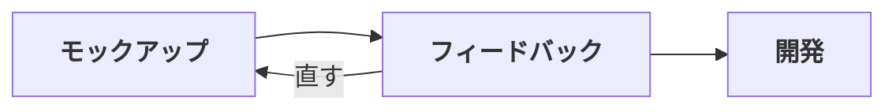

</Diagram>

## ツリー

上位の目的を、下位の要素に分解する。

<Diagram caption="例：エピックをユーザーストーリーに分ける">

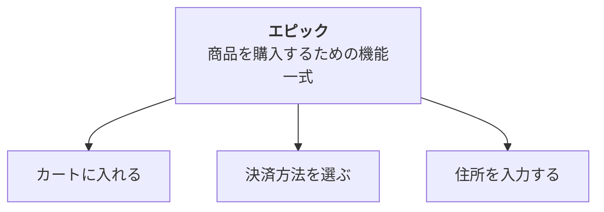

</Diagram>

## グループ

担当や場所ごとのまとまりと、その間の流れ。

<Diagram caption="例：顧客の行動と、顧客と接する従業員の行動">

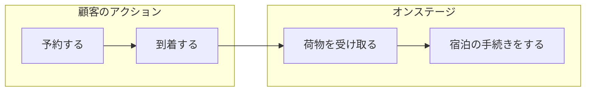

</Diagram>

## 2軸マトリクス

2つの軸で、4つの領域に分けて位置づける。

<Diagram caption="例：インパクトと労力">

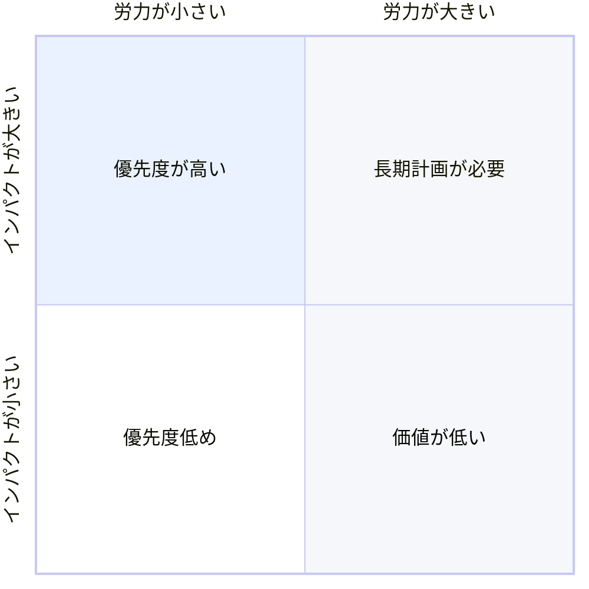

</Diagram>

## ベン図

2つ以上の集合の重なり。

<Diagram caption="例：PMFは、商品と市場が交わるところ">

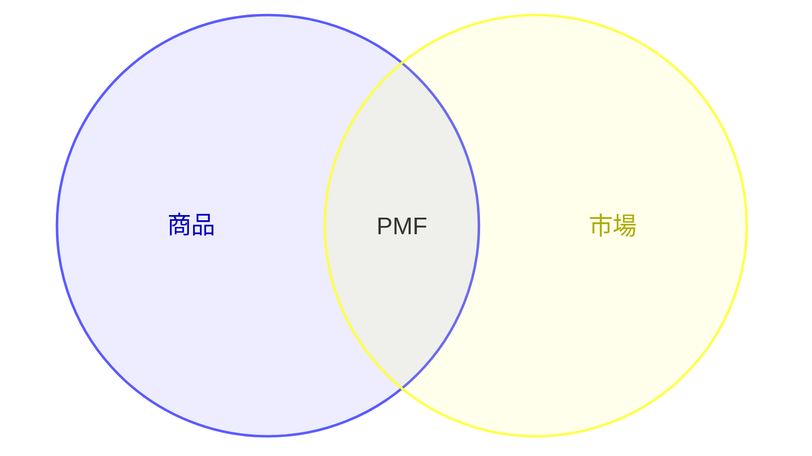

</Diagram>

## 特性要因図

1つの結果に対して、原因を分類して並べる。

<Diagram caption="例：有料プランが増えない原因の仮説">

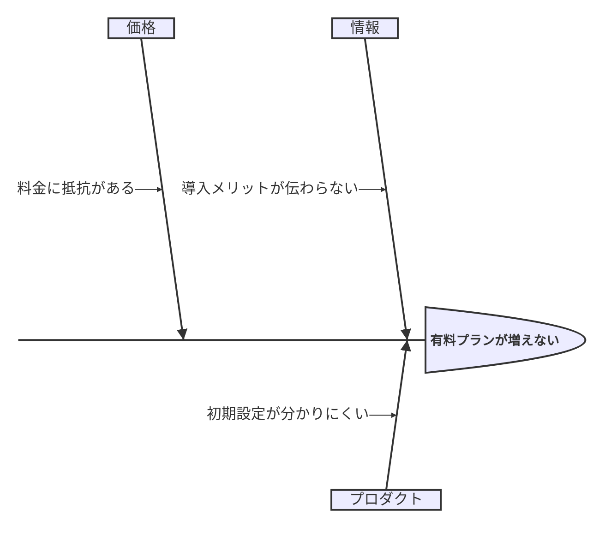

</Diagram>

## マインドマップ

1つのテーマから、分類が広がっていく様子。

<Diagram caption="例：要求の分類">

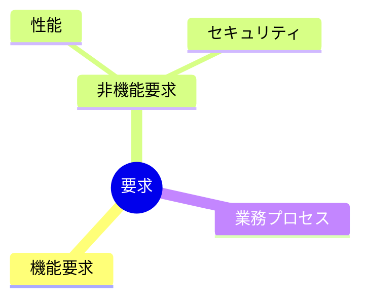

</Diagram>

## 状態遷移図

ものの状態と、その移り変わり。

<Diagram caption="例：チケットの状態">

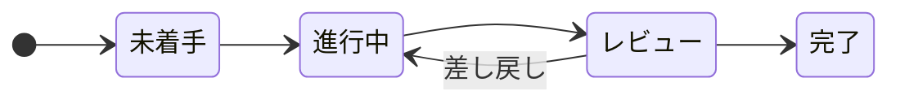

</Diagram>

## ガントチャート

期間と順番、依存関係。強調したい作業には `crit` を付ける。

<Diagram caption="例：長い経路がクリティカルパス">

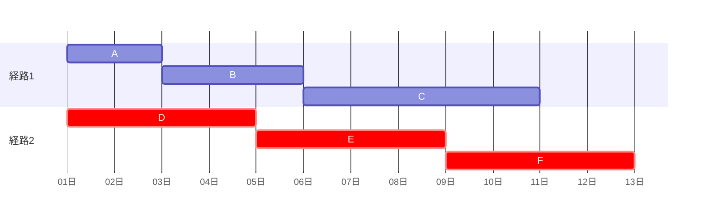

</Diagram>

## 層構造

下の層の上に、次の層が積み重なる関係。

<Diagram caption="例：ソフトウェアの層">

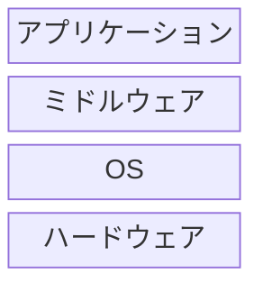

</Diagram>

## レーダー

複数の観点で、2〜3者を比べる。

<Diagram caption="例：訴求したい価値の比較">

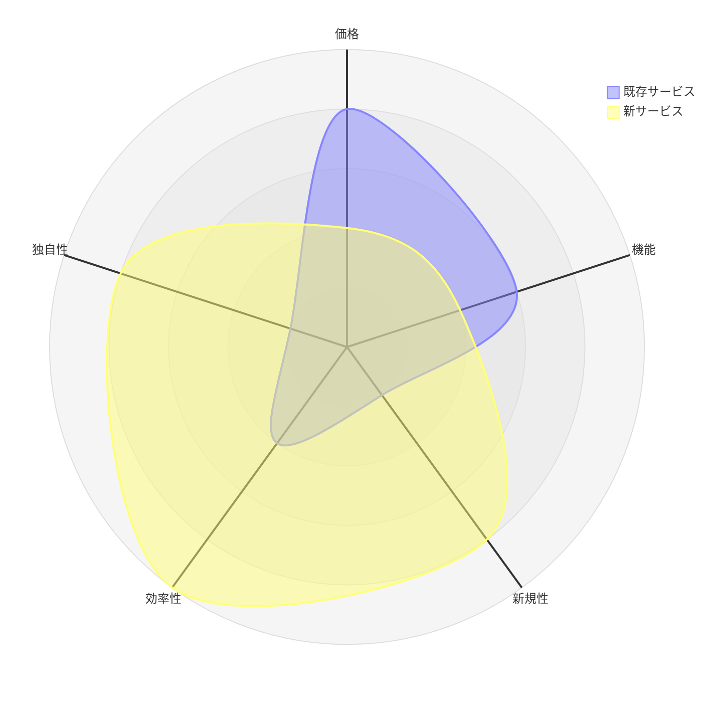

</Diagram>

## グラフ

数値の推移や大小。

<Diagram caption="例：棒グラフ">

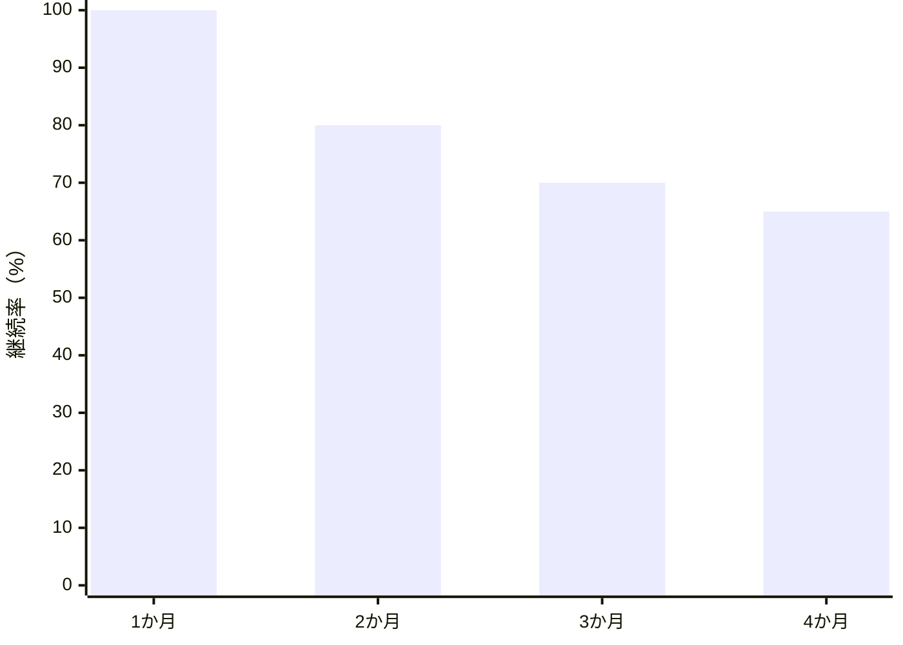

</Diagram>

## ジャーニー

段階ごとの行動と、そのときの気持ち（1〜5）。

<Diagram caption="例：購入までの体験">

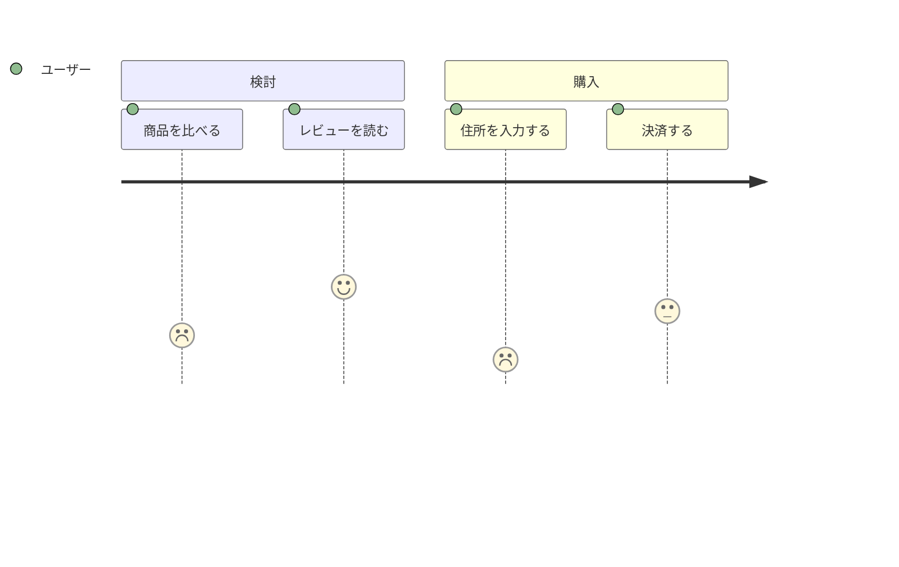

</Diagram>
